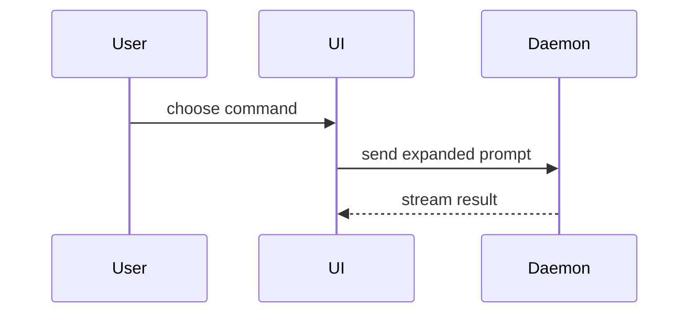

Use this template for writing the PR body. When the job is to finish a branch, not just to write a body, follow **Finishing a branch** at the end.

```markdown
## Summary

<diagram, diff-sketch, or tree>

## Evidence

- **Before:** <screenshot/output/failing test run>
  **After:** <screenshot/output/passing test run>

## Merge Danger

**Door:** <one-way or two-way>

<optional: description>

**Blast Radius:** <one-word description>

<optional: potential ramifications of merge>
```

## Sections

Skip all preambles and keep prose brief. Use the user's domain language from `GLOSSARY.md`.

### Summary

Pick the smallest view that makes the key point clear.

- Show logic or an algorithm as pseudocode:

```text
on(save)
  if content is unchanged
    return cached result
  write new content
  return fresh result
```

- Show runtime control flow as a call tree:

```text
submitForm
  createSession
    persistPrompt
    launchAgent
  navigateToSession
```

- Show UI structure as a component tree, including state and module boundaries that matter:

```text
<SessionPage> (apps/example/src/routes/session.tsx)
  useSessionEvents()
  <SessionToolbar>
    <RunSkillButton> (packages/ui)
```

- Show file responsibility or a broad refactor as a shallow file tree:

```text
src/
├── commands/       # parses user actions
├── sessions/       # owns session state
└── transport/      # sends API requests
```

- Show component interaction, control flow, or data flow with Mermaid:



- Use `diff` when the point is what changes and the surrounding shape already exists. Match the diff shape to the topic.

For a component change:

```diff
 <SessionPage>
   useSessionEvents()
   <SessionToolbar>
+    <RunSkillButton />
   <SessionTimeline>
+    <SkillResultCard />
```

For a file-layout change:

```diff
 src/
 ├── commands/
+│   └── show-me.ts       # expands the slash command
 ├── sessions/
-└── transport.ts
+└── transport/
+    ├── client.ts
+    └── stream.ts
```

For a call-tree or call-stack change:

```diff
 submitForm
   createSession
     persistPrompt
+    expandSkillMention
     launchAgent
-  navigateToSession
+  navigateToSession
+    subscribeToEvents
```

For a state or control-flow change:

```diff
 on(save)
-  write content
+  if content is unchanged
+    return cached result
+  write new content
+  invalidate cache
```

- Show the whole block when most of it is new, when omitted context would hide ownership or order, or when the user needs a copyable target shape:

```ts
function expandSkill(command: string): string {
  const skillName = command.slice(1);
  return `use the ${skillName} skill`;
}
```

#### Guidance

Place each visual next to the short text it supports. Keep only the calls, files, props, states, and boundaries needed to answer the user's current question or the options to resolve the current discussion point.

You may use one of these, you may use several, it is unlikely you will use all of them. Use your judgement and don't overwhelm the user.

### Evidence

Concrete evidence that the change works. Show a before and after.

Screenshots are S-tier - when the environment is set up for it and the change is visual.

Execution-based evidence is A-tier. Test results, console output. Show the exact test that now fails and passes, using pseudocode.

### Merge Danger

Describe whether it's a one-way or two-way door. You can walk back through two-way doors, but not one-way doors. A PR that is cheap to roll back is lower risk. Changes that involve destructive actions or hard-to-reverse decisions are one-way doors.

The blast radius is the potential impact or scope of the changes introduced by this PR. Consider all possibilities. Examples are layout shift, breakages for consumers, mobile responsiveness, etc.

## Finishing a branch

When the work on a branch is done and it's time to hand it over, run these in order. **Never merge** into the main branch, and never push to it: merging is the human's decision.

1. **Full suite.** Call the Skill tool with "verify-before-done" for the test, lint, typecheck and build commands in `docs/agents/commands.md`. A failure off the known-failure list stops here: report it.
2. **Whole-branch review.** Call the Skill tool with "code-review", with the merge-base with the main branch as the fixed point and the spec as the spec. Call the Skill tool with "review-feedback" on its findings and fix the accepted ones, re-running step 1 after any fix.

   If the caller hands you fresh evidence that steps 1 and 2 already ran at the current `HEAD` (a `/ship` run's ledger does), skip them and use that evidence.
3. **Open a PR or keep the branch.** Ask the user which, unless the caller already decided (a `/ship` run passes its **finish action**):
   - **Open a PR**: push the branch, then open the PR with the tracker's command from `docs/agents/issue-tracker.md` (`gh pr create`, `glab mr create`), using the template above as the body. Reference the spec and every ticket it closes with the tracker's closing keywords (`Closes #12`). Add any findings the reviews left open to Merge Danger.
   - **Keep the branch**: push it without a PR (a `/ship` run's `push-branch`), or leave it local if the user says so.
4. **Clean up**, only once a PR is open or the user has discarded the branch: remove worktrees and scratch files this work created, and return the main checkout to the main branch. Never delete a branch that has unmerged work. If the user discards one, show them the delete command and let them run it.
